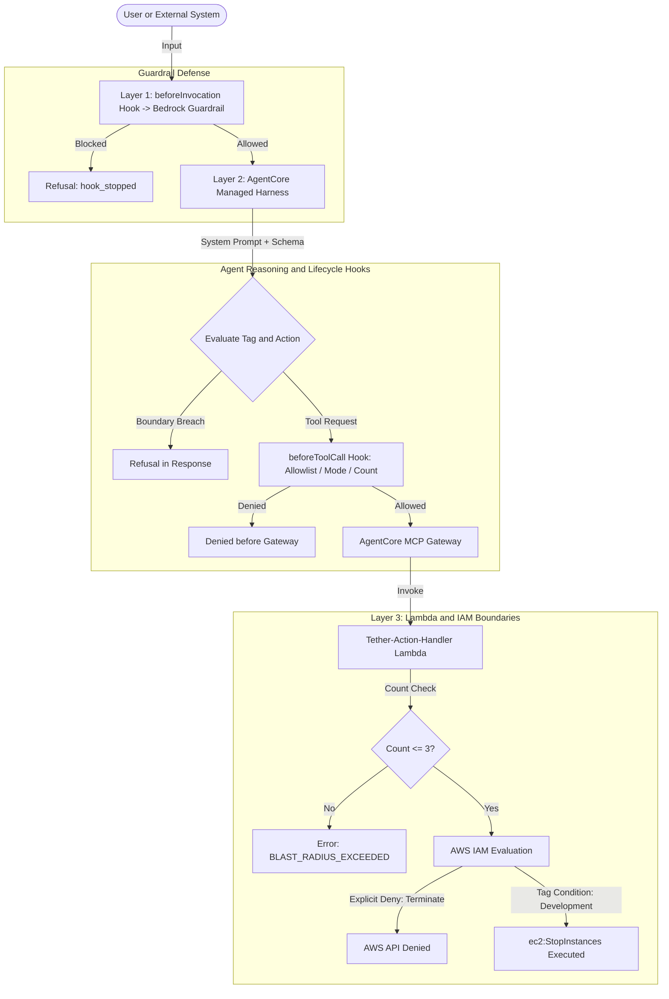

# Technical Architecture and Layered Defense Specification

Technical design and boundary enforcement model for Tether.
Reference: Issue #1 (https://github.com/primegideon/tether/issues/1)

---

## Architecture Overview

The system runs on AWS in region `us-east-1` using the **Amazon Bedrock AgentCore Managed Harness** (`Tether_Managed_Harness`):



---

## Layer Specifications

### 1. Layer 1: Amazon Bedrock Guardrail (`before_invocation` and `after_invocation` Hooks)
- Configuration Name: `Tether-Safety-Guardrail` (v2)
- Filters:
  - Content Filters: `PROMPT_ATTACK` (`HIGH` input), `HATE`, `INSULTS`, `MISCONDUCT` (`HIGH` input/output).
  - Denied Topic:
    - `PrivilegeEscalationAndBypass`: Requests attempting to override instructions, claim root/admin authority, or bypass IAM boundaries.
  - Sensitive Data Redaction:
    - Regex pattern for AWS Access Key IDs (`AWSAccessKeyId`, action `BLOCK`).

### 2. Layer 2: Amazon Bedrock AgentCore Managed Harness & `before_tool_call` Hook
- Runtime: `Tether_Managed_Harness` using `gemini-3.5-flash-lite` via AgentCore Identity (`tether-gemini-key`), integrated with `Tether-FinOps-Gateway` (MCP).
- Lifecycle Hook (`lambda/hook_handler.py`):
  - Enforces tool allowlist (`audit_waste`, `stop_dev_instances` only — blocks unexpected harness tools like `shell` or `subagent`).
  - Rejects any `mode != 'stop'` and rejects batches exceeding 3 instance IDs before tool execution.
- System Prompt (`agent/system_prompt.txt`) & Schema (`lambda/openapi_schema.json`):
  - `GET /audit-waste` (`audit_waste`): Read-only discovery.
  - `POST /stop-dev-instances` (`stop_dev_instances`): Typed schema with `instance_ids` (List of strings).
  - No delete or terminate endpoints are defined.

### 3. Layer 3: IAM Physical Boundary Policy
The Lambda execution role policy implements deterministic constraints independent of model output:

```json
{
  "Version": "2012-10-17",
  "Statement": [
    {
      "Sid": "AllowReadInventory",
      "Effect": "Allow",
      "Action": [
        "ec2:DescribeInstances",
        "ec2:DescribeVolumes",
        "cloudwatch:GetMetricData"
      ],
      "Resource": "*"
    },
    {
      "Sid": "AllowStopDevOnly",
      "Effect": "Allow",
      "Action": "ec2:StopInstances",
      "Resource": "arn:aws:ec2:us-east-1:*:instance/*",
      "Condition": {
        "StringEquals": {
          "aws:ResourceTag/Environment": "Development"
        }
      }
    },
    {
      "Sid": "ExplicitDenyDestructiveActions",
      "Effect": "Deny",
      "Action": [
        "ec2:TerminateInstances",
        "ec2:DeleteVolume",
        "rds:DeleteDBInstance",
        "rds:DeleteDBCluster",
        "s3:DeleteBucket"
      ],
      "Resource": "*"
    }
  ]
}
```

---

## Multi-Layer Verification
If an adversarial input bypasses Layer 1 (Guardrails) and causes Layer 2 (Agent prompt) to request an unauthorized action, Layer 3 (AWS IAM and Lambda runtime) blocks the action. This ensures boundary enforcement does not rely solely on probabilistic model behavior.
