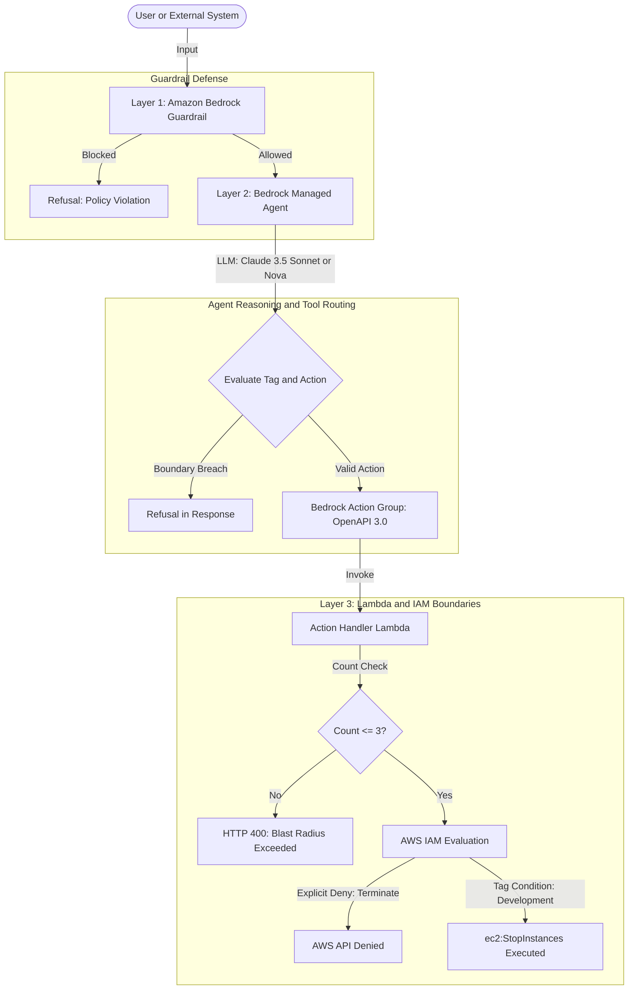

# Technical Architecture and Layered Defense Specification

Technical design and boundary enforcement model for Tether.
Reference: Issue #1 (https://github.com/primegideon/bedrock-finops-janitor/issues/1)

---

## Architecture Overview

The system runs on AWS in region `us-east-1` using Amazon Bedrock Managed Agents:



---

## Layer Specifications

### 1. Layer 1: Amazon Bedrock Guardrail
- Configuration Name: `Tether-Safety-Guardrail`
- Filters:
  - Content Filter: High threshold on standard harmful content categories.
  - Prompt Attack Filter: Active inspection for prompt injection, jailbreaks, and prompt overrides.
  - Denied Topics:
    - Destructive Cloud Actions: Requests to terminate instances, delete storage volumes, or drop databases.
    - Privilege Escalation: Requests to assume administrative or root privileges.
  - Sensitive Data Redaction:
    - Regex patterns for AWS Access Key IDs, Secret Keys, and internal network addresses.

### 2. Layer 2: Bedrock Managed Agent
- Model: Anthropic Claude 3.5 Sonnet or Amazon Nova Pro.
- System Prompt:
  - Defines the operational role strictly as an automated FinOps Auditor.
  - Enforces mandatory verification of the `Environment` tag before generating tool input.
- Tool Interface (OpenAPI 3.0):
  - `GET /audit-waste`: Read-only discovery.
  - `POST /stop-dev-instances`: Typed schema with `instance_ids` (List of strings) and optional `confirmation_token`.
  - No delete or terminate endpoints are defined.

### 3. Layer 3: IAM Physical Boundary Policy
The Lambda execution role policy implements deterministic constraints independent of model output:

```json
{
  "Version": "2012-10-17",
  "Statement": [
    {
      "Sid": "AllowReadInventory",
      "Effect": "Allow",
      "Action": [
        "ec2:DescribeInstances",
        "ec2:DescribeVolumes",
        "cloudwatch:GetMetricData"
      ],
      "Resource": "*"
    },
    {
      "Sid": "AllowStopDevOnly",
      "Effect": "Allow",
      "Action": "ec2:StopInstances",
      "Resource": "arn:aws:ec2:us-east-1:*:instance/*",
      "Condition": {
        "StringEquals": {
          "aws:ResourceTag/Environment": "Development"
        }
      }
    },
    {
      "Sid": "ExplicitDenyDestructiveActions",
      "Effect": "Deny",
      "Action": [
        "ec2:TerminateInstances",
        "ec2:DeleteVolume",
        "rds:DeleteDBInstance",
        "rds:DeleteDBCluster",
        "s3:DeleteBucket"
      ],
      "Resource": "*"
    }
  ]
}
```

---

## Multi-Layer Verification
If an adversarial input bypasses Layer 1 (Guardrails) and causes Layer 2 (Agent prompt) to request an unauthorized action, Layer 3 (AWS IAM and Lambda runtime) blocks the action. This ensures boundary enforcement does not rely solely on probabilistic model behavior.
